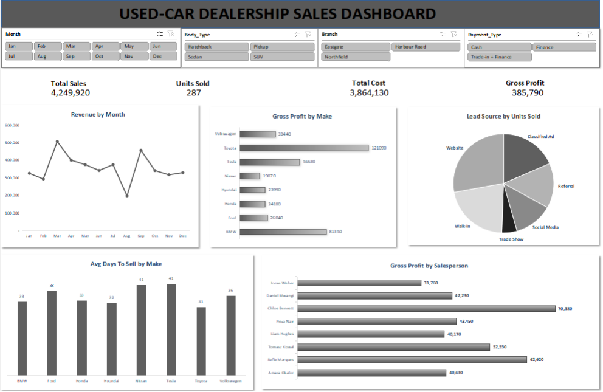

# Used-Car-Dealership-Microsoft-Excel-Dashboard

An end-to-end Excel analysis of one year (Jan to Dec 2025) of used-car sales across 3 branches and 8 salespeople. The project covers data cleaning, calculated columns, pivot tables, and an interactive dashboard with slicers, followed by the business insights.

## Project files

| File | Contents |
|---|---|
| used_car_dealership_dataset.xlsx | Raw data: Sales (289 rows, 16 columns) and Salespeople (8 rows) |
| Car_Dealership_Dashboard.xlsx | Cleaned data, calculated columns, 9 pivot tables, 5 charts, 4 slicers, KPI dashboard |
| dashboard.png | Screenshot of the final dashboard |

## Dataset

Sales sheet columns: Sale_ID, Sale_Date, Stock_Date, Make, Model, Body_Type, Year, Mileage, Purchase_Cost, Recon_Cost, List_Price, Sale_Price, Lead_Source, Payment_Type, Salesperson_ID, Customer_Rating.

Salespeople sheet columns: Salesperson_ID, Name, Branch, Hire_Date.

Coverage: 8 makes, 20 models, 4 body types (SUV, Hatchback, Sedan, Pickup), 6 lead sources, 3 payment types, 3 branches (Eastgate, Harbour Road, Northfield).

## Step 1: Data cleaning

| Issue found | Action |
|---|---|
| 2 exact duplicate rows (CS0026, CS0201) | Removed, so 289 rows became 287 |
| Inconsistent Make casing (toyota, TOYOTA, volkswagen, ...) | Standardised |
| Trailing spaces in Lead_Source ("Walk-in ", "Website ", "Social Media ") | Trimmed |
| 4 missing Mileage values | Left blank, not used in profit metrics |
| 33 missing Customer_Rating values (11.5%) | Left blank; averages use rated sales only |

## Step 2: Calculated columns

| Column | Formula | Worked example (CS0006, VW Tiguan) |
|---|---|---|
| Month | TEXT(Sale_Date, "MMM") | Jan |
| Days_To_Sell | Sale_Date − Stock_Date | 2 Jan − 29 Dec = 4 days |
| Vehicle_Age | 2025 − Year | 2025 − 2017 = 8 years |
| Total_Cost | Purchase_Cost + Recon_Cost | 9,470 + 2,110 = 11,580 |
| Gross_Profit | Sale_Price − Total_Cost | 11,930 − 11,580 = 350 |
| Profit_Margin_Pct | Gross_Profit / Sale_Price | 350 / 11,930 = 2.9% |
| Discount_Pct | (List_Price − Sale_Price) / List_Price | (12,870 − 11,930) / 12,870 = 7.3% |
| Salesperson, Branch | Looked up from the Salespeople table via Salesperson_ID | SP01 = Amara Okafor, Eastgate |

## Step 3: Dashboard

- **KPI cards:** Units Sold, Total Sales, Total Cost, Gross Profit
- **Charts:** Revenue by Month (line), Gross Profit by Make (bar), Lead Source by Units Sold (pie), Avg Days To Sell by Make (column), Gross Profit by Salesperson (bar)
- **Slicers:** Month, Body_Type, Branch, Payment_Type
- **Built with:** Excel tables, calculated columns, lookups, 9 pivot tables, pivot charts, slicers

## Key results

| Metric | Value |
|---|---|
| Units sold | 287 |
| Total sales | 4,249,920 |
| Total cost | 3,864,130 |
| Gross profit | 385,790 |
| Overall margin | 385,790 / 4,249,920 = 9.1% |
| Avg gross profit per car | 1,344 |
| Avg days to sell | 34.8 |
| Avg discount off list | 6.0% |
| Avg customer rating | 3.77 / 5 |

## Insights

### 1. Profit is concentrated in a few makes

| Make | Units | Gross Profit | Margin | Avg GP/car |
|---|---|---|---|---|
| Toyota | 61 | 121,090 | 12.1% | 1,985 |
| BMW | 27 | 81,350 | 12.6% | 3,013 |
| Tesla | 21 | 56,630 | 11.5% | 2,697 |
| Volkswagen | 46 | 33,440 | 6.4% | 727 |
| Ford | 40 | 26,040 | 5.4% | 651 |
| Honda | 33 | 24,180 | 5.9% | 733 |
| Hyundai | 33 | 23,990 | 6.0% | 727 |
| Nissan | 26 | 19,070 | 6.6% | 733 |

Toyota, BMW and Tesla are 109 of 287 cars (38%) but make (121,090 + 81,350 + 56,630) / 385,790 = 67% of all profit. Toyota alone is 31%.

### 2. Hatchbacks sell in volume but earn almost nothing

| Body type | Units | Gross Profit | Margin | Avg GP/car |
|---|---|---|---|---|
| Pickup | 29 | 80,070 | 14.2% | 2,761 |
| Sedan | 54 | 93,850 | 10.6% | 1,738 |
| SUV | 112 | 191,200 | 9.8% | 1,707 |
| Hatchback | 92 | 20,670 | 2.4% | 225 |

Hatchbacks are 32% of units (92/287) but only 5.4% of profit (20,670/385,790). Pickups earn about 12x more per car (2,761 / 225).

### 3. 54 sales (19%) were sold at a loss

- 54 of 287 sales had negative gross profit, totalling −34,290.
- 37 of the 54 were hatchbacks, so 37/92 = 40% of hatchbacks lost money.
- By model, the Ford Focus (−1,910) and VW Polo (−2,870) lost money overall.
- Loss-making sales were on older cars: average age 6.3 years vs 5.0 for all sales.

### 4. Older cars are far less profitable

| Vehicle age (yrs) | 2 | 3 | 4 | 5 | 6 | 7 | 8 |
|---|---|---|---|---|---|---|---|
| Avg GP/car | 2,561 | 1,967 | 1,728 | 1,454 | 796 | 720 | 236 |

Correlation of Gross_Profit with Vehicle_Age is −0.47 and with Mileage is −0.47 (age and mileage are almost the same signal at 0.94). Profit drops sharply after year 5. Cars aged 6 to 8 years should be bought cheaper or avoided.

### 5. Discounting hurts profit, and waiting longer doesn't help

- Correlation of Discount_Pct with Gross_Profit is −0.28 (a moderate negative link).
- Correlation of Days_To_Sell with Gross_Profit is −0.04, so there is no real link. Holding a car longer did not earn more.
- Toyota sells fastest (30.7 days avg) while Tesla (40.9) and Nissan (40.5) are slowest.

### 6. Seasonality

- Best revenue month: March (506,020). Worst: August (196,030, only 17 units).
- February had the weakest profit (13,060 on 292,290 revenue = 4.5% margin).
- Quarterly revenue fell from 1,123,150 in Q1 to 985,190 in Q4, a drop of (985,190 − 1,123,150) / 1,123,150 = −12.3%.
- Q3 had the highest gross profit (107,580), Q4 the lowest (82,040).

### 7. Salespeople

| Salesperson | Branch | Units | Gross Profit | Avg GP/car | Avg discount |
|---|---|---|---|---|---|
| Chloe Bennett | Eastgate | 37 | 70,380 | 1,902 | 5.9% |
| Sofia Marques | Harbour Road | 40 | 62,620 | 1,566 | 5.2% |
| Tomasz Kowal | Harbour Road | 43 | 52,550 | 1,222 | 5.8% |
| Priya Nair | Northfield | 30 | 43,450 | 1,448 | 4.7% |
| Daniel Mwangi | Harbour Road | 34 | 42,230 | 1,242 | 7.7% |
| Amara Okafor | Eastgate | 30 | 40,630 | 1,354 | 5.7% |
| Liam Hughes | Eastgate | 37 | 40,170 | 1,086 | 5.6% |
| Jonas Weber | Northfield | 36 | 33,760 | 938 | 7.1% |

Chloe Bennett leads on profit with fewer sales than Tomasz Kowal, who sold the most cars (43) but ranks third on profit. Jonas Weber and Daniel Mwangi give the deepest discounts and earn the least per car. Sofia Marques sells fastest (29.4 days).

### 8. Branches

| Branch | Units | Gross Profit | Margin | Avg GP/car | Avg rating |
|---|---|---|---|---|---|
| Harbour Road | 117 | 157,400 | 8.9% | 1,345 | 3.68 |
| Eastgate | 104 | 151,180 | 9.9% | 1,454 | 3.73 |
| Northfield | 66 | 77,210 | 8.1% | 1,170 | 3.98 |

Harbour Road sells the most, but Eastgate is the most profitable per car. Northfield has the lowest profit but the best customer ratings.

### 9. Lead sources and payment type

| Lead source | Units | Avg GP/car | Margin | Avg rating |
|---|---|---|---|---|
| Website | 80 | 1,213 | 8.5% | 3.62 |
| Walk-in | 62 | 1,426 | 9.1% | 4.04 |
| Classified Ad | 53 | 1,241 | 8.9% | 3.76 |
| Referral | 42 | 1,653 | 10.5% | 3.71 |
| Social Media | 36 | 1,333 | 8.7% | 3.50 |
| Trade Show | 14 | 1,223 | 9.2% | 4.31 |

Website brings the most leads but not the best profit. Referrals produce the highest profit per car and a fast sale (30.8 days). Trade Show has the best ratings, but only 14 sales. For payment type, Trade-in + Finance earns the most per car (1,517), Finance is the most common (133 of 287, 46%), and Cash is the fastest (32.6 days) but earns the least (1,253).

## Recommendations

1. Prioritize stocking Toyota, BMW, Tesla and pickups, which carry the margin.
2. Review pricing on Ford Focus, VW Polo and other hatchbacks, since 40% of them lose money.
3. Cap the age of purchased cars at about 5 years, or negotiate lower purchase prices for older ones.
4. Set a discount floor so that Sale_Price stays above Purchase_Cost + Recon_Cost.
5. Invest more in referrals, and coach the lowest-profit salespeople on discounting.
6. Plan stock and promotions around the weak months (Feb, Aug, Q4).

## Limitations

- Customer_Rating is missing for 33 sales, so rating insights are indicative only.
- Some groups are small (Ranger, Trade Show), so treat their numbers carefully.
- Correlations show association, not cause.
- The dataset covers a single year and a single dealership group.

## Tools & skills demonstrated

Excel tables, data cleaning, calculated columns, lookups, pivot tables, pivot charts, slicers, KPI dashboard design, business analysis.
